<!-- This file is auto-generated. if you do not want it to be overwritten, set TRUE in the line below -->
<!-- DO_NOT_OVERWRITE_DOC=FALSE -->

# Installation Close Check

## Flow Diagram [(_View History_)](Installation_Close_Check-history.md)

<!-- Flow description -->

## General Information

|<!-- -->|<!-- -->|
|:---|:---|
|Object|Installation__c|
|Process Type|Auto Launched Flow|
|Trigger Type|Record Before Save|
|Record Trigger Type|Update|
|Label|Installation Close Check|
|Status|Active|
|Does Require Record Changed To Meet Criteria|✅|
|Description|An installation cannot be closed without an install date.|
|Environments|Default|
|Interview Label|Installation Close Check {!$Flow.CurrentDateTime}|
|BuilderType (PM)|LightningFlowBuilder|
|CanvasMode (PM)|AUTO_LAYOUT_CANVAS|
|Connector|[No_Install_Date](#no_install_date)|
|Next Node|[No_Install_Date](#no_install_date)|

#### Filters (logic: **and**)

|Filter Id|Field|Operator|Value|
|:-- |:-- |:--:|:--: |
|1|Status__c|Equal To|Completed|

## Flow Nodes Details

### Check_Handover_Fault

|<!-- -->|<!-- -->|
|:---|:---|
|Type|Custom Error|
|Label|Check Handover Fault|
|Description|Handover Fault Path|
|Custom Error Messages|errorMessage: There has been an error isFieldError: false |

### Handover_Item_Error_Message

|<!-- -->|<!-- -->|
|:---|:---|
|Type|Custom Error|
|Label|Handover Item Error Message|
|Description|Error message|
|Custom Error Messages|errorMessage: Handover Items not complete isFieldError: false |

### Install_Date_Missing

|<!-- -->|<!-- -->|
|:---|:---|
|Type|Custom Error|
|Label|Install Date Missing|
|Description|Refuses to close an installation that was never given an install date.|
|Custom Error Messages|errorMessage: Set the install date before closing this installation. isFieldError: false |

### Handover_exist

|<!-- -->|<!-- -->|
|:---|:---|
|Type|Decision|
|Label|Handover exist?|
|Description|Checks if there is a handover item what is not complete|
|Default Connector Label|Default Outcome|

#### Rule Exists (Exists)

|<!-- -->|<!-- -->|
|:---|:---|
|Connector|[Handover_Item_Error_Message](#handover_item_error_message)|
|Condition Logic|and|

|Condition Id|Left Value Reference|Operator|Right Value|
|:-- |:-- |:--:|:--: |
|1|[Check_Handover](#check_handover)|Is Null|False|

### No_Install_Date

|<!-- -->|<!-- -->|
|:---|:---|
|Type|Decision|
|Label|No Install Date|
|Description|Was the installation ever given an install date?|
|Default Connector|[Check_Handover](#check_handover)|
|Default Connector Label|Install date set|

#### Rule Date_Missing (Date missing)

|<!-- -->|<!-- -->|
|:---|:---|
|Connector|[Install_Date_Missing](#install_date_missing)|
|Condition Logic|and|

|Condition Id|Left Value Reference|Operator|Right Value|
|:-- |:-- |:--:|:--: |
|1|$Record.Install_Date__c|Is Null|True|

### Check_Handover

|<!-- -->|<!-- -->|
|:---|:---|
|Type|Record Lookup|
|Object|Handover_Item__c|
|Label|Check Handover|
|Description|Retrieves any handover items that have not been completed|
|Assign Null Values If No Records Found|⬜|
|Fault Connector|[Check_Handover_Fault](#check_handover_fault)|
|Get First Record Only|✅|
|Store Output Automatically|✅|
|Connector|[Handover_exist](#handover_exist)|

#### Filters (logic: **and**)

|Filter Id|Field|Operator|Value|
|:-- |:-- |:--:|:--: |
|1|Installation__c|Equal To|$Record.Id|
|2|Is_Done__c|Equal To|⬜|

___

_Documentation generated from branch monitoring_orgfarm_46e8f3e0ad_dev_ed_develop by [sfdx-hardis](https://sfdx-hardis.cloudity.com), featuring [salesforce-flow-visualiser](https://github.com/toddhalfpenny/salesforce-flow-visualiser)_